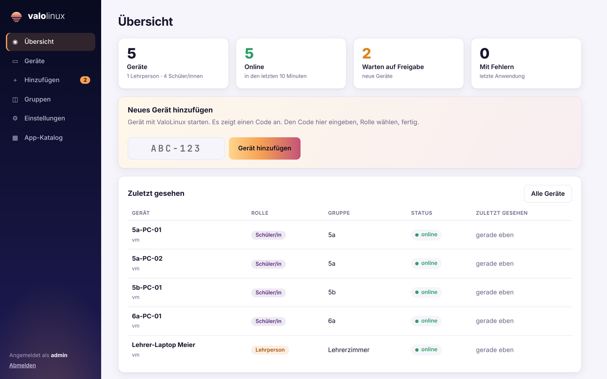

# ValoLinux

Minimales, zentral verwaltetes Linux-Image für Schulgeräte (Kiosk-Konzept).
Langfristiges Einzelprojekt, aktuell **Testprojekt – kein Produktivbetrieb vor dem Pilot (Phase 5)**.

ValoLinux ist **keine eigene Distribution**, sondern ein Image-Builder (auf Debian Stable)
plus eine Verwaltungsschicht (Agent + Web-UI).

## Idee in Kürze
- Image flashen → Gerät in der Web-UI **adoptieren** → Rolle (Lehrer/Schüler) zuweisen → fertig.
- Geräte holen Konfiguration per Pull vom Server (Manifest = Soll-Zustand).
- Updates image-basiert (A/B, signiert, Rollback), keine Paket-Updates auf dem Gerät.
- Zustandslos: Home wird beim Abmelden gelöscht.

## Struktur
| Pfad | Inhalt |
|---|---|
| `docs/entscheidungen.md` | Getroffene Entscheidungen und Begründungen |
| `docs/architektur.md` | Architektur, Rollen, Sicherheit |
| `docs/home-und-konten.md` | Home-Verhalten, zentrale Konten (Entwurf) |
| `docs/phasen.md` | Phasenplan mit Fortschritt |
| `docs/verifikation.md` | Unsichere Fakten: was zu prüfen ist, Ergebnisse |
| `docs/verwaltung.md` | Server, Web-UI, Agent: Start, Adoption, Einstellungen |
| `image/` | Live-ISO (live-build), Build per GitHub Actions bei Release |
| `crates/valo-proto/` | Gemeinsame Typen und Signaturen (Rust) |
| `agent/` | Geräte-Agent (Rust) |
| `server/` | Web-UI + API (Rust, Docker) |
| `manifests/` | Beispiel-Manifeste je Rolle |
| `tools/` | Hilfsskripte (z. B. RAM-Messung Phase 0) |

## Schnellstart Verwaltung
```bash
docker compose -f server/docker-compose.yml up -d --build
```
Dann `http://<server>:8080` öffnen. Details: `docs/verwaltung.md`.



## Arbeitsregeln
Siehe `docs/entscheidungen.md`, Abschnitt „Regeln". Kurz: bewährte Technik, alles reversibel,
erst in QEMU testen, nichts erfinden (verifizieren und notieren), bei Sicherheit/Schlüsseln nachfragen.
