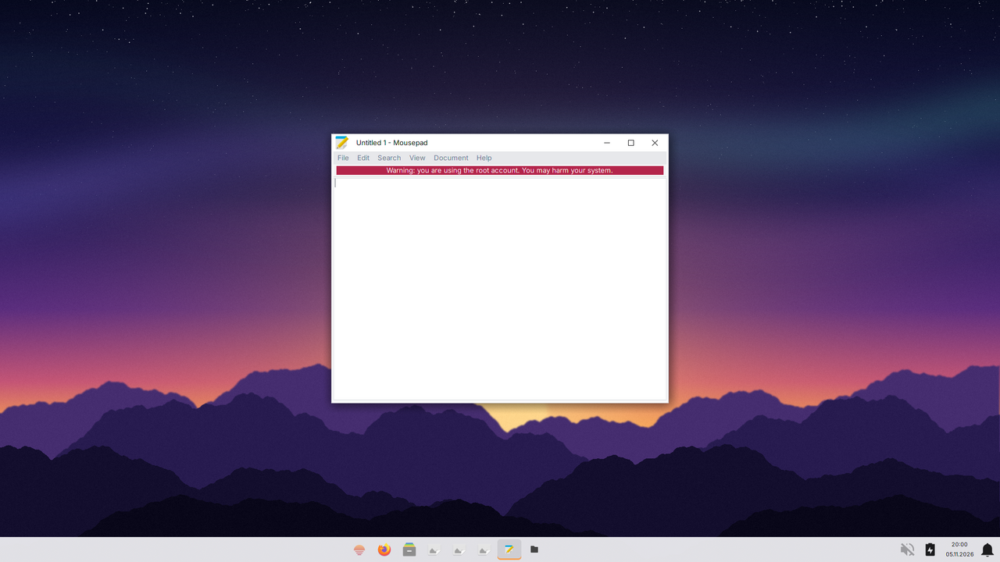
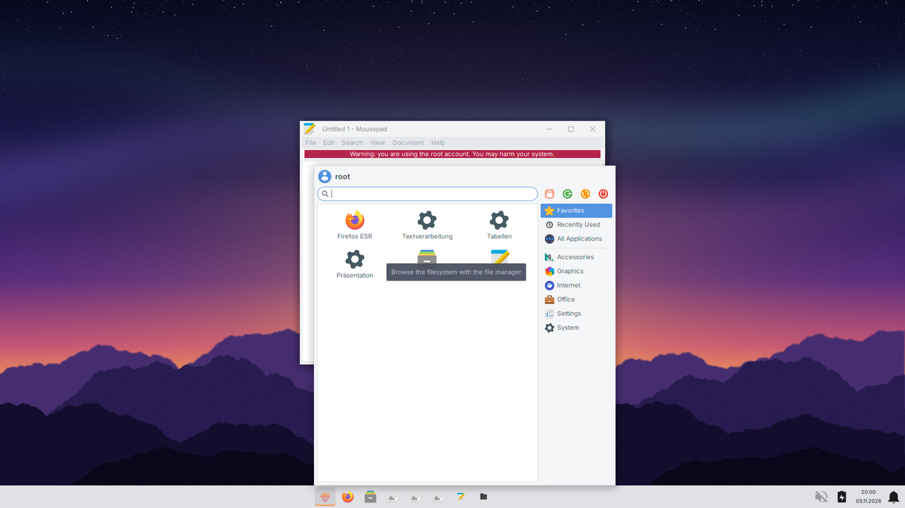
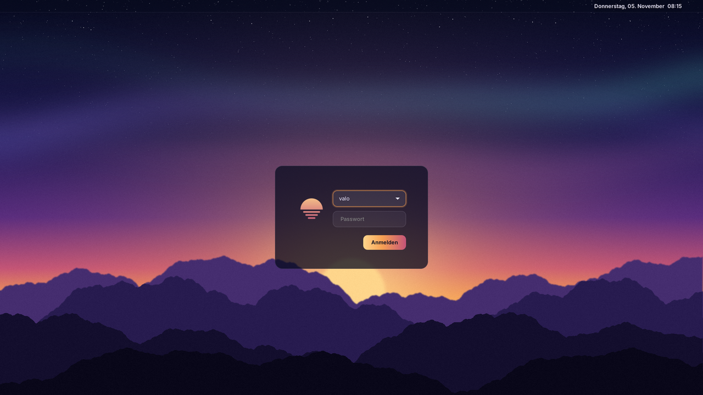
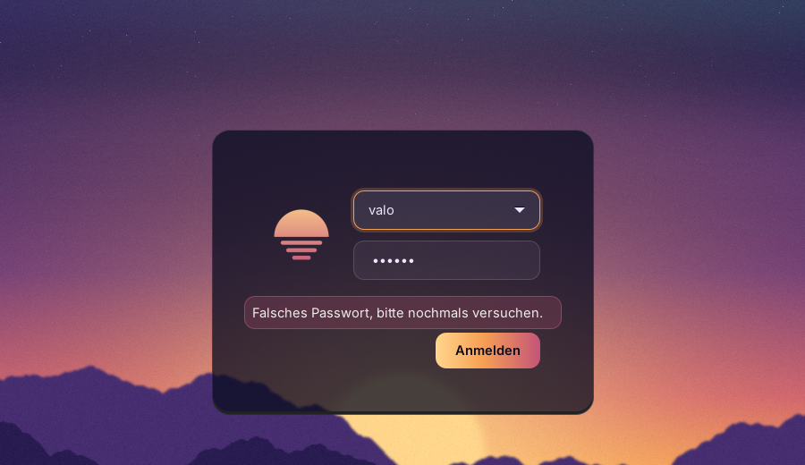

# Design

**Idee:** „valo“ heisst auf Finnisch „Licht“. Bildwelt: Morgendämmerung über einer Bergkette, also Nachthimmel, Polarlicht, aufgehende Sonne. Ruhig, warm, nicht verspielt (Schule).

## Logo
Sonnenaufgang: halbe Sonne über dem Horizont, darunter drei Spiegelungsstreifen, Verlauf Sonnengelb → Rosé.
Wortmarke: **valo** (Inter Display Bold, weiss) + linux (Inter Light, helles Lavendel), klein geschrieben.

## Farben
| Name | Hex | Verwendung |
|---|---|---|
| Night | `#080B20` | Hintergründe, dunkelste Fläche |
| Indigo | `#1E1B54` | Flächen, Panels |
| Violet | `#582C80` | Akzent dunkel |
| Rose | `#C45478` | Akzent, Logo unten |
| Amber | `#F7A054` | Hauptakzent (Buttons, Fokus) |
| Sun | `#FFD68C` | Highlights, Logo oben |
| Lavender | `#EBE8FF` | Text auf Dunkel |

## Schrift
Inter (OFL-Lizenz) für UI und Wortmarke, im Image als `fonts-inter`.

## Dateien
Alle Grafiken erzeugt `tools/make-branding.py` reproduzierbar (fester Zufallswert):
- `usr/share/backgrounds/valolinux.png`: Desktop, 1920×1080, Logo unten links
- `usr/share/backgrounds/valolinux-greeter.png`: Greeter, ohne Logo
- `usr/share/backgrounds/valolinux-splash.png`: Boot-Menü, 640×480
- `usr/share/pixmaps/valolinux-logo.png`: Logo 256×256 (Greeter-Benutzerbild)

## Desktop (XFCE, ähnlich Windows 11)
- Taskleiste unten, hell und leicht transparent, Start und Apps zentriert; aktive App mit Amber-Strich.
- Fensterdesign „ValoLinux“ (`usr/share/themes/ValoLinux/xfwm4`, erzeugt mit `tools/make-xfwm-theme.py`): weisse Titelleiste, breite flache Knöpfe, Schliessen rot beim Darüberfahren.
- GTK: Arc (hell), Symbole: Papirus-Light, Schrift: Inter 10. Kleine CSS-Anpassungen in `usr/share/valolinux/gtk.css`.
- Vorgaben: `etc/xdg/xfce4/` (Panel, Whisker-Menü, Fenster, Schriften), beim Anmelden ergänzt durch `usr/local/libexec/valolinux/session` und `xfce-setup` (Hintergrund pro Bildschirm, Tastenkürzel).

## Greeter (entschieden: LightDM GTK Greeter)
Eigenes GTK-Theme **ValoLinux** (`usr/share/themes/ValoLinux/gtk-3.0/gtk.css`), baut auf dem in GTK eingebauten Adwaita dark auf und gestaltet nur den Greeter:
- Login-Karte: dunkles, halbtransparentes Glas, runde Ecken, Logo als Benutzerbild
- Eingabefelder mit Amber-Fokusring, Anmelden-Button im Sonnenverlauf (Sun → Amber → Rose)
- Fehlermeldung in Rosé, obere Leiste mit Uhr, Sitzung und Ein/Aus, Menüs im gleichen Stil
- Konfiguration: `etc/lightdm/lightdm-gtk-greeter.conf`

**Vorschau ohne LightDM:** `tools/preview-greeter.py` lädt die originale `.glade`-Oberfläche des Greeters mit unserem Theme und macht in Xvfb einen Screenshot (Anleitung im Skriptkopf). Die Vorschau ist nah dran, aber nicht identisch mit dem echten Greeter (z. B. fehlen dort die Icons für Sitzung/Ein-Aus, der Schatten-Effekt fehlt in beiden, weil GTK3 ihn abschneidet).

## Greeter-Optionen (Übersicht)
| Greeter | Aussehen | Gewicht | Bemerkung |
|---|---|---|---|
| **LightDM GTK Greeter** (aktuell) | klassisch, gut anpassbar | sehr leicht | Stabil, in Debian |
| Slick Greeter (LightDM) | modern, grosses Hintergrundbild, Benutzerliste | leicht | In Debian, von Linux Mint |
| greetd + tuigreet | Textmodus | minimal | Sehr robust, aber nüchtern |
| SDDM | modern, QML-Themes | schwerer (Qt) | Viel Design möglich, mehr RAM |
| Kein Greeter (nur Autologin) | – | – | Für reine Schülergeräte mit Gerätekonto passend |

Schülergeräte mit gemeinsamem Gerätekonto brauchen eigentlich keinen Greeter (Autologin). Wichtig wird er erst mit persönlichen Konten (siehe `home-und-konten.md`).
