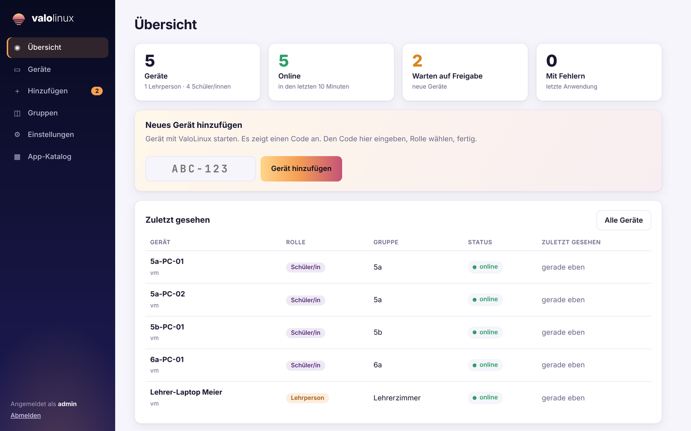
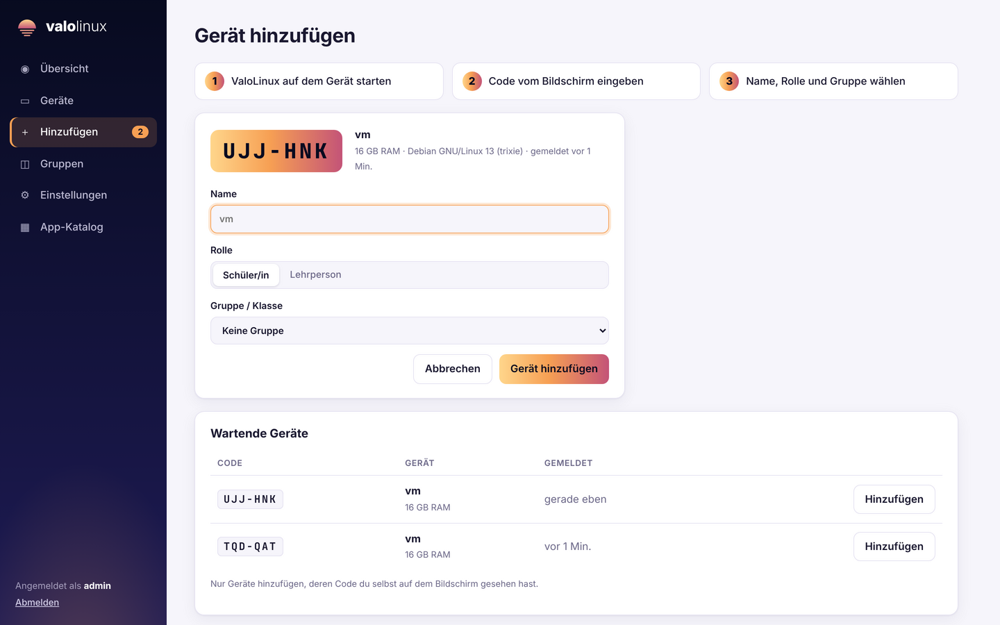
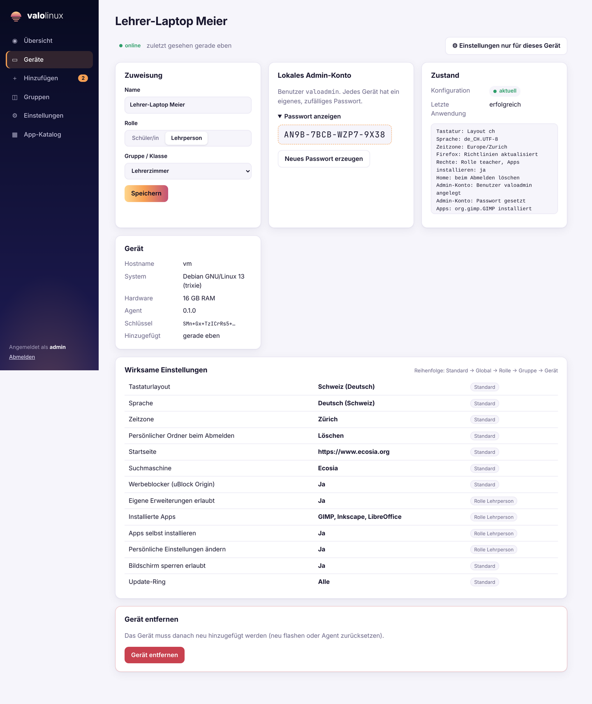
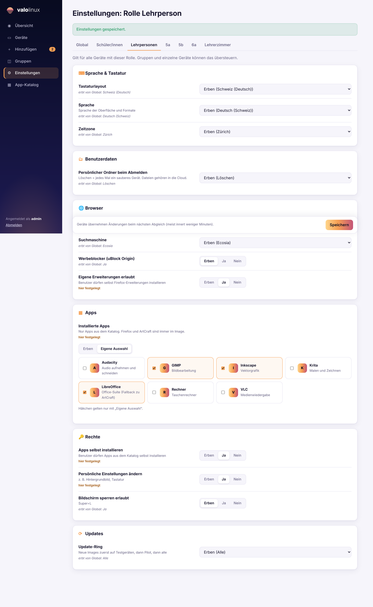
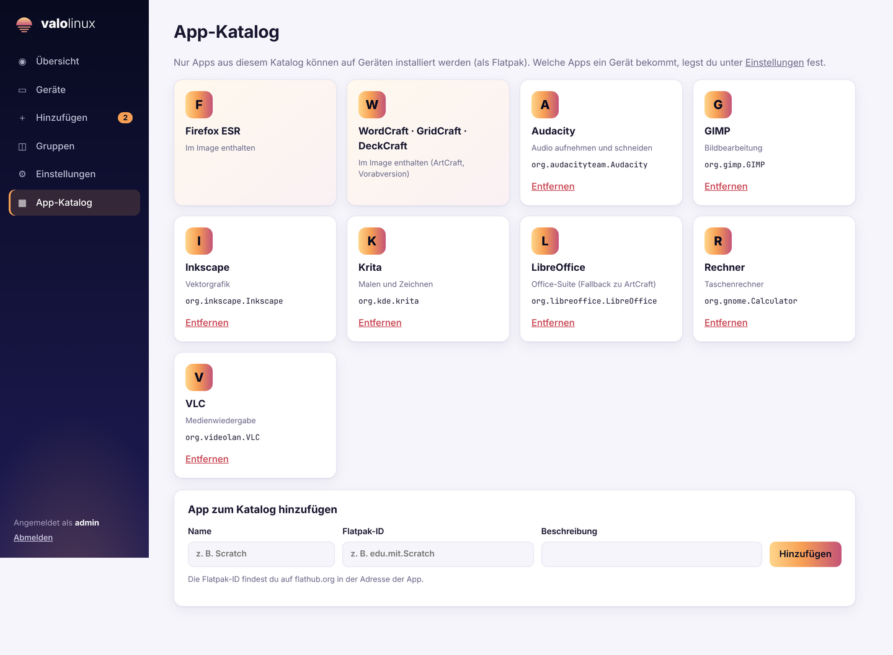

# Verwaltung: Server, Web-UI und Agent

Stand: 2026-11-05. Phase 3 (MVP), **nicht produktiv einsetzen**.

## Überblick
```
 Gerät (valo-agent)  ──HTTPS/HTTP, signierte Anfragen──▶  valo-server (Docker)  ◀── Admin im Browser
   │ meldet sich mit eigenem Schlüssel an                  │ Web-UI: Geräte, Gruppen, Einstellungen, Apps
   │ zeigt Code an, bis ein Admin es hinzufügt             │ signiert jedes Manifest mit dem Server-Schlüssel
   └ holt Manifest, prüft Signatur, wendet an, meldet zurück
```
- **Rust**, ein Workspace: `crates/valo-proto` (gemeinsame Typen, Signaturen), `server/`, `agent/`.
- **Identitäten:** Jedes Gerät erzeugt beim ersten Start einen ed25519-Schlüssel. Der Server hat ebenfalls einen (`/data/server.key`). Das Gerät merkt sich den Server-Schlüssel bei der Anmeldung und lehnt danach Manifeste mit anderem Schlüssel ab.
- **Transport:** vorerst einfaches HTTP(S) mit signierten Anfragen. Der Wechsel auf iroh (Phase 4) ändert nur die Transportschicht, nicht die Nachrichten.

## Server starten
```bash
docker compose -f server/docker-compose.yml up -d --build
```
Dann `http://<server>:8080` öffnen und das erste Admin-Konto anlegen.

Ohne Docker (Entwicklung):
```bash
cargo run -p valo-server        # Daten in ./data, Port 8080
```
Umgebungsvariablen: `VALO_DATA_DIR` (Standard `./data`), `VALO_LISTEN` (`0.0.0.0:8080`), `VALO_SECURE_COOKIES=1` hinter HTTPS.

**Sicherung:** Das Verzeichnis `/data` (Docker-Volume `valo-data`) enthält Datenbank **und** Server-Schlüssel. Geht der Schlüssel verloren, müssen alle Geräte neu hinzugefügt werden.

## Gerät hinzufügen (Adoption)
1. Gerät mit ValoLinux starten. Server-Adresse kommt aus `/etc/valolinux/agent.conf` (`server = http://…`) oder dem Boot-Parameter `valo.server=http://…`.
2. Das Gerät zeigt einen 6-stelligen Code (Dialog auf dem Desktop und auf der Konsole vor dem Login).
3. In der Web-UI unter **Hinzufügen** den Code eingeben, Name, Rolle (Schüler/in, Lehrperson) und Gruppe wählen.
4. Innert ca. 10 Sekunden holt sich das Gerät seine Konfiguration. Danach prüft es alle 5 Minuten.

## Einstellungen
Ebenen, die spätere gewinnt: **Standard → Global → Rolle → Gruppe → Gerät**. Jede Einstellung kann auf einer Ebene „erben“ oder einen eigenen Wert haben. Die Geräteseite zeigt, welcher Wert wirkt und woher er kommt.

| Einstellung | Wirkung auf dem Gerät (Debian) |
|---|---|
| Tastatur | `/etc/default/keyboard`, `/etc/X11/xorg.conf.d/00-keyboard.conf` (gilt ab nächster Anmeldung) |
| Sprache | `/etc/locale.gen` + `locale-gen`, `/etc/default/locale` |
| Zeitzone | `/etc/timezone`, `/etc/localtime` |
| Persönlicher Ordner | `/etc/valolinux/home-mode`, LightDM löscht `/home/valo` nach dem Abmelden |
| Browser | `/etc/firefox/policies/policies.json` (Startseite, Suchmaschine, uBlock, Erweiterungen) |
| Apps | Flatpak von Flathub, nur aus dem Katalog; der Agent entfernt nur, was er selbst installiert hat |
| Rechte | `/etc/valolinux/permissions.json`, polkit-Regel für Flatpak |
| Admin-Konto | Benutzer `valoadmin`, Passwort pro Gerät zufällig (Web-UI: Gerät → Passwort anzeigen) |
| Name | Hostname |

## Agent
```bash
valo-agent enroll --server http://server:8080   # anmelden, Code anzeigen
valo-agent run                                   # Dauerbetrieb (systemd: valo-agent.service)
valo-agent run --once                            # ein Abgleich
valo-agent status
valo-agent reset                                 # Identität vergessen -> neuer Code
```
Testen ohne Eingriff ins System: `--root /tmp/testroot` schreibt alle Dateien dorthin und führt keine Befehle aus (`--dry-run` nur Befehle nicht ausführen).

Offline: Der Agent wendet beim Start das letzte gültige Manifest aus dem Cache an.

## Sicherheit (Stand)
- Admin-Passwörter mit Argon2, Sitzungen serverseitig, CSRF-Token in allen Formularen, Cookies `HttpOnly; SameSite=Strict`.
- Geräte-Anfragen sind signiert (Zeitfenster 5 Min.), Manifeste sind signiert.
- **Offen:** 2FA für Admins, HTTPS direkt im Server (bis dahin Reverse-Proxy), Verschlüsselung der gespeicherten Geräte-Admin-Passwörter, Rechteverwaltung für mehrere Admins, iroh-Transport.
- Wer den Server kontrolliert, kontrolliert alle Geräte. Web-UI nicht ins Internet stellen.

## Tests
```bash
cargo test --workspace
```
Der Server-Test spielt den ganzen Ablauf durch (Setup, Login, Anmeldung, Adoption, Einstellungen, signiertes Manifest, Bericht, alle Seiten).

## Screenshots





